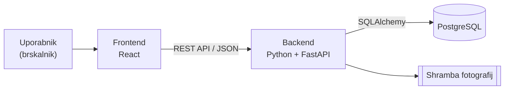

# Arhitektura in tehnološki sklad

## Arhitektura

**Glavni deli sistema**
- Frontend – React aplikacija v brskalniku
- Backend – REST API v Pythonu (FastAPI) s poslovno logiko
- Podatkovna baza – PostgreSQL
- Shramba fotografij – mapa na strežniku

**Komunikacija**
- Frontend ↔ backend: REST API, JSON
- Backend ↔ baza: SQLAlchemy (ORM)

**Podatkovna baza**
- PostgreSQL, tabele in spremembe prek migracij (Alembic)

**Avtentikacija**
- registracija samo z vabilom
- gesla zgoščena z bcrypt
- prijava z JWT žetonom
- backend preveri vlogo uporabnika pri vsakem zahtevku

**Lokalni zagon**
- baza: `docker compose up -d db`
- backend: `pip install -r requirements.txt`, `uvicorn app.main:app --reload`
- frontend: `npm install`, `npm run dev`

### Diagram

## Tehnološki sklad

- **Frontend:** React, Vite, Tailwind CSS
- **Backend:** Python, FastAPI
- **Podatkovna baza:** PostgreSQL, SQLAlchemy, Alembic
- **Avtentikacija:** JWT, bcrypt
- **Lokalni razvoj:** Docker, Git + GitHub
- **Drugo:** pytest (testi), Swagger UI (dokumentacija API)
- **E-pošta:** Brevo
- **Calendar:** @fullcalendar/react

## Arhitekturne odločitve

- **React** – razširjen, z njim imam izkušnje
- **Python (FastAPI)** – z njim imam izkušnje, preprost in hiter za izdelavo API-ja
- **PostgreSQL** – podatki so med seboj povezani, zato je primerna relacijska baza
- **Docker** – enostaven lokalni zagon baze brez ročne namestitve
